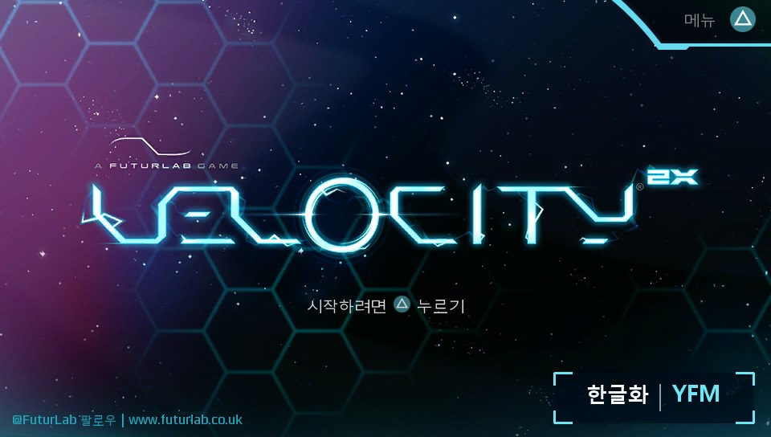
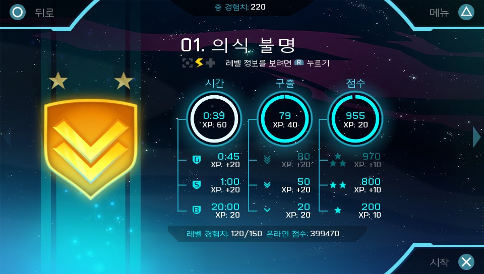
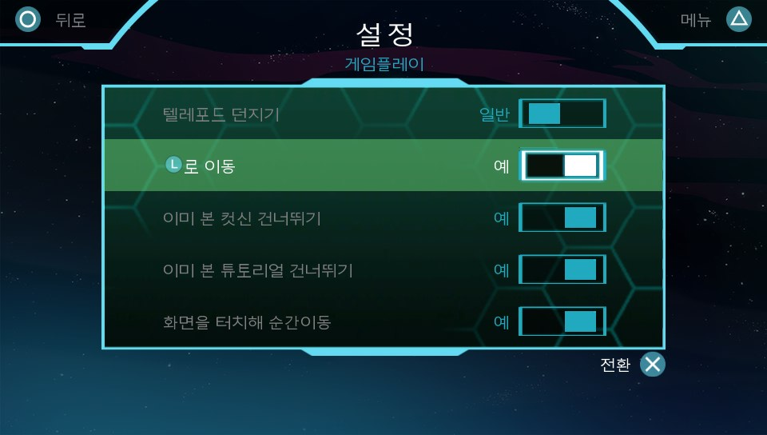
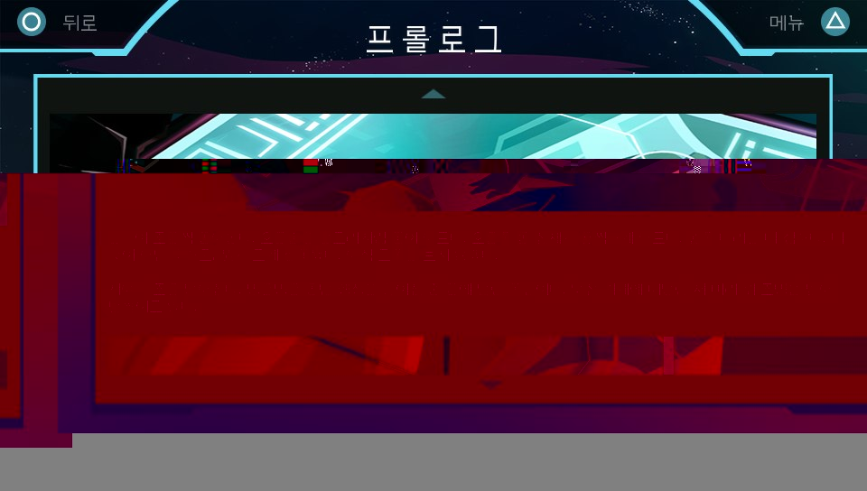

# Velocity 2X PS Vita 한글패치 v0.9.0

## 게임 소개

| 항목 | 내용 |
| --- | --- |
| 게임명 | **Velocity 2X (벨로시티 2X)** |
| 개발 | FuturLab |
| 패치 대상 | PS Vita 미국판 **PCSE00374** |
| 배포 버전 | **0.9.0 베타** |
| 메타크리틱 | **90점 / 100점** — [PS Vita판 평론가 리뷰 10개 기준](https://www.metacritic.com/game/velocity-2x/critic-reviews/?platform=playstation-vita) |

**Velocity 2X**는 우주선을 조종하는 슈팅과 주인공 카이 타나의 횡스크롤 액션을 오가며 진행하는 게임입니다. 순간이동과 빠른 이동을 활용해 적을 돌파하고, 각 레벨에서 목표 시간과 점수에 도전할 수 있습니다.

## 한글패치 소개

미국판 게임의 영어 텍스트와 게임 첫 화면을 한글화한 rePatch용 패치입니다. 메뉴, 설정, 비행 컴퓨터, 프롤로그, 장면, 튜토리얼, 레벨 정보와 추가 콘텐츠의 목록·설명에 한글을 적용했습니다. 한글 글꼴도 포함합니다.

실기에서 확인한 화면은 아래 사진을 참고해 주세요. 전체 레벨의 진행 확인은 아직 끝나지 않았습니다.

## 적용 범위

| 항목 | 내용 |
| --- | --- |
| 게임 텍스트 | 번역 문자열 1,391개 ID 적용 |
| 글꼴 | 한글 833자 및 다섯 종류의 게임 글꼴 적용 |
| 첫 화면 | 타이틀 이미지 수정 |
| 추가 콘텐츠 | 목록과 설명 번역, 듀얼 코어 팩 표시 확인 |
| LiveArea | 변경하지 않음 |

## 화면 사진

## 다운로드

[설치용 rePatch ZIP](Velocity2X_PCSE00374_Korean_v0.9.0_rePatch.zip)

## 설치 방법

대상은 미국판 **PCSE00374**입니다. 기기에 게임과 공식 업데이트, rePatch가 설치되어 있어야 합니다.

1. 게임을 완전히 종료합니다.
2. 기존 `ux0:rePatch/PCSE00374` 폴더가 있다면 다른 위치에 백업합니다.
3. ZIP을 풀고 안의 `rePatch` 폴더를 PSV의 `ux0:` 최상위에 복사합니다.
4. `ux0:rePatch/PCSE00374/stringtable.xls.txt`, `fonts`, `Atlases`가 있는지 확인합니다.
5. 게임 언어를 **English**로 설정하고 실행합니다.

## 확인 상태와 알려진 문제

- 시작 화면, 메뉴, 설정, 프롤로그, 레벨 정보에서 한글 표시를 실기로 확인했습니다.
- **긴급 임무 팩(Critical Urgency Pack)**은 목록과 설명까지 표시되지만 첫 스테이지 로딩 중 **C2-12828-1** 오류로 종료됩니다. 사용자가 게임을 다시 설치한 뒤에도 rePatch 적용 시 같은 현상을 확인했습니다. rePatch를 적용하지 않았을 때는 실행된 사례가 있어, rePatch 적용 상태와의 연관성이 강합니다. 정확한 충돌 원인은 아직 확인되지 않았습니다.
- 듀얼 코어 팩은 실행된 사례가 있으나 모든 스테이지를 검증하지 않았습니다.
- 전체 게임 진행 검증은 완료되지 않았습니다.

## 문제 제보

오류가 난 화면과 시점, 사진, 게임 업데이트 버전, 설치한 DLC, rePatch 플러그인 이름·버전, `ux0:rePatch/PCSE00374`의 활성 여부를 함께 알려주세요. 폴더명을 바꿔 비교했다면 기기를 재부팅했는지도 적어주세요.

## 복구

게임을 종료하고 `ux0:rePatch/PCSE00374`를 다른 위치로 옮기거나 삭제한 뒤, 백업한 폴더가 있다면 복원합니다. 적용 상태를 확실히 구분하려면 기기를 재부팅한 후 게임을 다시 실행하세요.

## 제작 및 출처

- **YourFaceMonster** — 프로젝트 진행, 실기 확인 및 배포
- **Codex (OpenAI)** — 데이터 분석, 번역·글꼴 적용 및 패키지 제작 지원
- **FuturLab** — 원작 게임 개발
- **[rePatch reDux0](https://github.com/dots-tb/rePatch-reDux0)** — PSV 패치 적용 방식 참고

비공식 팬 한글패치입니다. 게임과 추가 콘텐츠는 별도로 소유해야 합니다. 게임 관련 자료에 임의의 오픈소스 라이선스를 부여하지 않습니다.

